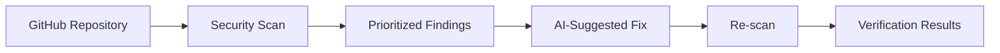

# DevFlow AI — Autonomous Repository Security Dashboard & Remediation Platform


[](https://fastapi.tiangolo.com)
[](https://react.dev)
[](https://vitejs.dev)
[](https://python.org)
[](https://tailwindcss.com)

# 🛡️ DevFlow AI

### Scan. Understand. Fix. Verify.

**AI-assisted repository security analysis and remediation.**

DevFlow AI helps developers identify potential vulnerabilities in GitHub repositories, understand security risks, generate suggested fixes, and verify proposed changes through re-scanning.

## ✨ Features

<details>
<summary><strong>🔍 Repository Security Scanning</strong></summary>

- Inspect supported Python files from GitHub repositories.
- Detect potential vulnerabilities using Bandit.
- Review findings by severity, confidence, and affected code.

</details>

<details>
<summary><strong>🤖 AI-Assisted Fixes</strong></summary>

- Explain vulnerabilities in plain English.
- Generate suggested code fixes and unified diffs.
- Review proposed changes before applying them.

</details>

<details>
<summary><strong>✅ Fix Verification</strong></summary>

- Re-scan proposed changes.
- Identify findings that remain detectable.
- Distinguish resolved issues from unverified results.

</details>

<details>
<summary><strong>📊 Reports & Notifications</strong></summary>

- View scan history and security findings.
- Export supported audit reports and patches.
- Configure security notifications where integration is available.

</details>

## ⚙️ How It Works



## 🧰 Tech Stack

| Frontend | Backend | Security |
|---|---|---|
| React + Vite | Python + FastAPI | Bandit |
| TypeScript | SQLite | AI-assisted analysis |

## 🚀 Getting Started

**Backend**

```bash
cd backend
python3 -m venv .venv
source .venv/bin/activate
pip install -r requirements.txt
cp .env.example .env
uvicorn app.main:app --reload --port 8000
```

**Frontend** — open a second terminal:

```bash
cd frontend
pnpm install
pnpm run dev
```

Configure the required environment variables before using AI-powered features. Use the package manager matching your committed lockfile.

- Frontend: `http://localhost:5173` (or the port Vite displays)
- API documentation: `http://localhost:8000/docs`

## 🔐 Security First

- Repository code is untrusted input and must not be executed during static analysis.
- API keys must remain on the backend.
- Proposed patches require review and testing.
- Failed or incomplete scans must never be reported as clean.

## 👥 Team

**Built by the DevFlow AI team.**

*AI-assisted security analysis is not a guarantee that a repository is vulnerability-free.*


