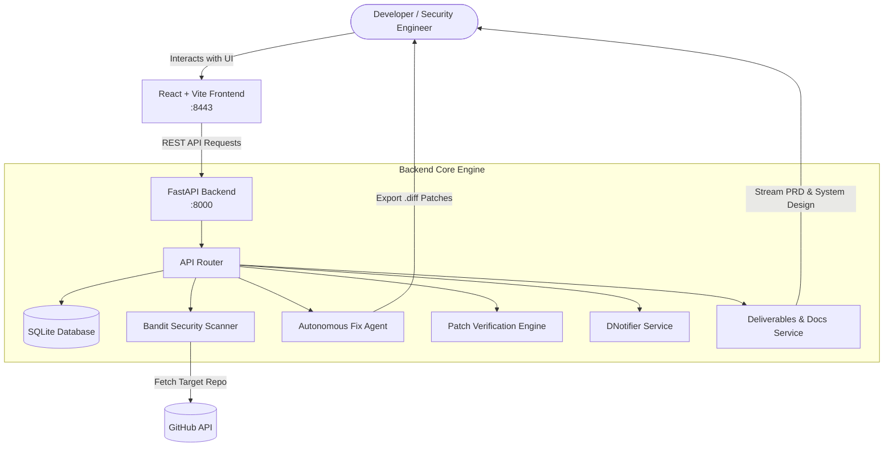

# DevFlow AI — Autonomous Repository Security Dashboard & Remediation Platform


[](https://fastapi.tiangolo.com)
[](https://react.dev)
[](https://vitejs.dev)
[](https://python.org)
[](https://tailwindcss.com)

**DevFlow AI** is a production-grade, full-stack cybersecurity platform designed to automate repository security audits, detect code vulnerabilities in real time, generate precise patch diffs, and verify fixes using simulated in-place re-scans.

---

## 🌟 Key Features

1. **Autonomous Repository Auditing:**
   - Deep inspection of GitHub repositories for Python security vulnerabilities.
   - Powered by the Bandit static security analyzer with granular rule attribution (e.g. `B101`, `B608`, `B105`, `B303`).
   - Categorizes findings by severity (`CRITICAL`, `HIGH`, `MEDIUM`, `LOW`) and confidence scores.

2. **Automated Fix Generation & Unified Diffs:**
   - AI and heuristic agents generate targeted unified diff patches (`.diff`) directly from code evidence and line numbers.
   - Provides plain-English vulnerability summaries, risk assessments, and remediation reasoning.

3. **In-Place Patch Verification & Rescan Engine:**
   - Validates suggested patches in an isolated sandbox environment without altering production repositories.
   - Re-runs static checks against the patched code to ensure the vulnerability is genuinely resolved with zero regressions.

4. **Multi-Channel Security Notifications:**
   - Integrated with DNotifier API for dispatching real-time vulnerability alerts and scan summaries directly to engineering teams.

5. **Downloadable Deliverables & Audit Exports:**
   - **PRD (`DevFlow-AI-PRD.md`)**: Full Product Requirements Document downloadable with one click from the UI.
   - **System Design (`DevFlow-AI-System-Design.md`)**: Architecture, C4 diagrams, and component models.
   - **Unified Diff Patches (`fix_<rule>_<finding>.diff`)**: Exportable diff files ready for `git apply`.
   - **Executive Security Audit Report (`DevFlow-Report-<scan_id>.md`)**: Complete markdown audit reports.

6. **High-Contrast Cinematic UI:**
   - Built to match Figma design specifications with dark minimalist aesthetic (`#07070d`), vibrant yellow accents (`#f4c453`), and smooth glassmorphism.

---

## 🏗️ System Architecture



---

## 📂 Project Structure

```text
hackathon/
├── backend/
│   ├── app/
│   │   ├── api/
│   │   │   └── routes.py         # REST endpoints for scans, fixes, verification & downloads
│   │   ├── core/
│   │   │   ├── bandit_runner.py  # Static analysis runner
│   │   │   ├── fix_agent.py      # Automated patch generation
│   │   │   ├── rescan_engine.py  # Sandbox patch validation
│   │   │   └── dnotifier.py      # DNotifier notification service
│   │   ├── db/
│   │   │   └── database.py       # SQLite connection and migration schema
│   │   ├── models/
│   │   │   └── schemas.py        # Pydantic schemas and validation
│   │   ├── config.py             # App settings and environment variables
│   │   └── main.py               # FastAPI application entrypoint
│   ├── tests/                    # Comprehensive unit tests (16/16 passing)
│   ├── requirements.txt
│   └── .env.example
├── frontend/
│   ├── src/
│   │   ├── app/
│   │   │   └── routes.tsx        # Dashboard, Scans, Finding Drawer & Docs views
│   │   ├── components/           # UI cards, tables, drawers, navigation
│   │   ├── pages/                # Hero page and dashboard views
│   │   ├── services/
│   │   │   └── api.js            # Centralized API service & Blob download utilities
│   │   └── styles/
│   ├── package.json
│   ├── vite.config.ts
│   └── index.html
├── docs/                         # 10 detailed architecture & specification guides
│   ├── 00-project-charter.md
│   ├── 01-requirements.md
│   ├── 02-system-architecture.md
│   ├── 03-agent-and-workflow-design.md
│   ├── 04-api-contracts.md
│   ├── 05-data-model.md
│   ├── 06-security-and-threat-model.md
│   ├── 07-implementation-roadmap.md
│   ├── 08-testing-and-quality-plan.md
│   ├── 09-dnotifier-integration.md
│   └── 10-demo-and-presentation-plan.md
├── hackathon.md                  # Comprehensive PRD Document
├── .gitignore
└── README.md
```

---

## 🚀 Getting Started

### Prerequisites
- Python 3.10+
- Node.js 18+ & npm
- Git

---

### 1. Backend Setup

```bash
cd backend

# Create virtual environment
python3 -m venv .venv
source .venv/bin/activate

# Install dependencies
pip install -r requirements.txt

# Configure environment variables
cp .env.example .env
# Edit .env with your optional GEMINI_API_KEY, APP_ID, and APP_SECRET

# Run database migrations and start server
uvicorn app.main:app --host 0.0.0.0 --port 8000 --reload
```

Backend will be available at: `http://localhost:8000`  
API Swagger Documentation: `http://localhost:8000/docs`

---

### 2. Frontend Setup

```bash
cd frontend

# Install dependencies
npm install

# Configure environment variables
cp .env.example .env.local

# Start development server
npm run dev
```

Frontend will be available at: `http://localhost:8443` (or `http://localhost:5173`)

---

## 🧪 Running Tests

### Backend Unit Tests
```bash
cd backend
.venv/bin/python -m unittest discover tests
```
*Executes all 16 integration and unit test suites covering scanner, fix generator, DNotifier, API routes, and download endpoints.*

### Frontend Production Build
```bash
cd frontend
npm run build
```

---

## 📥 Downloadable Deliverables API

| Endpoint | Method | Description |
| :--- | :--- | :--- |
| `/api/docs/prd` | `GET` | Downloads `DevFlow-AI-PRD.md` |
| `/api/docs/system-design` | `GET` | Downloads `DevFlow-AI-System-Design.md` |
| `/api/scans/{scan_id}/fixes/{proposal_id}/download` | `GET` | Downloads unified diff patch (`fix_{proposal_id}.diff`) |
| `/api/scans/{scan_id}/export/report` | `GET` | Downloads security audit markdown report |

---

## 👥 Authors & Acknowledgments

Crafted with excellence by the **DevFlow Engineering Team**.
