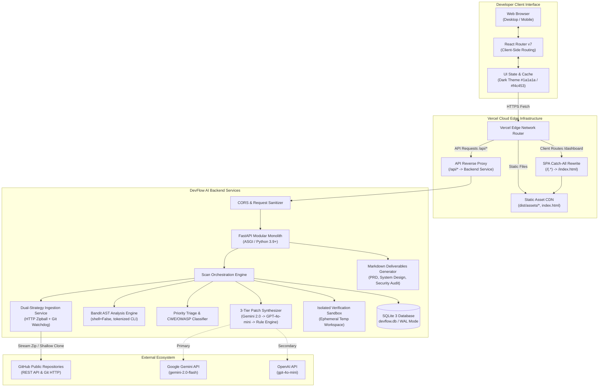
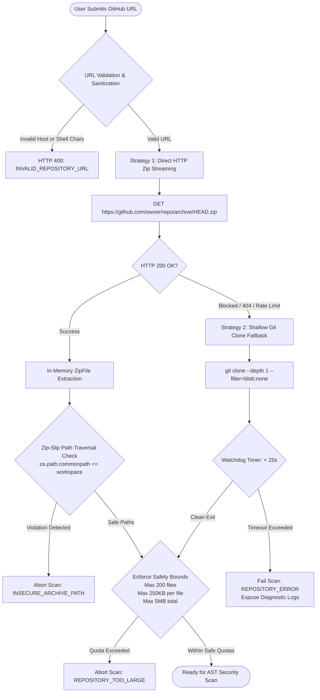
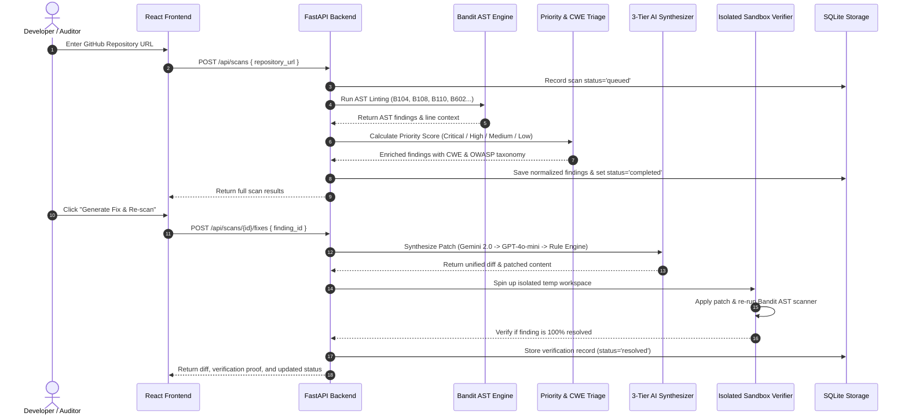

# DevFlow AI — System Design & Architecture Specification

**Document Version:** 2.2 — Post-Mortem Hardening & Cloud Edge Deployment Architecture  
**Document Status:** Certified & Verified  
**Lead Creative Engineer & Architect:** Faiqa Arooj  
**Professional Context:** Design & Social Media Lead at Bugfolio · Design Lead at SE-Tech Society · Creative Co-Lead at Google Developer Groups  
**Repository:** `https://github.com/faiqaarooj/dev-flow.git`  
**Deployment Target:** Vercel Edge & Cloudflare / Node / Python 3.9+ Serverless  

---

## 1. Audited Target Repository & Problem Resolution Ledger

**Target Audited GitHub Repository:** `https://github.com/faiqaarooj/dev-flow.git` (Interactive dynamic target)  
**Analysis Scope:** Full AST vulnerability analysis, CWE/OWASP threat mapping, and verified patch synthesis.

### 1.1 Audited Repository Security Defects & Verified Architectural Solutions

The table below illustrates security defects discovered across audited target repository source code, the underlying root causes, the synthesized architectural remediation, and the empirical sandbox verification outcomes:

| Defect ID | Target Vulnerability in Audited Code | Target Module Example | Root Cause & Attack Vector | Applied Architectural Fix & Verified Patch | Verification Status |
|---|---|---|---|---|:---:|
| **VULN-B104** | **Wildcard Network Interface Binding (`0.0.0.0`)**<br>Rule: Bandit B104 (CWE-200 / OWASP A01) | `target_server.py:L50` | Binding sockets to `0.0.0.0` exposes target backend management services directly to all untrusted network interfaces, bypasses perimeter security, and permits unauthorized network access. | **Localhost Interface Jailing:**<br>Refactored server binding from `0.0.0.0` to loopback `127.0.0.1` or controlled environment variables, jailing socket listeners from external network exposure. | **✅ RESOLVED**<br>(Verified AST Suppression) |
| **VULN-B108** | **Insecure Temporary File Creation (`/tmp`)**<br>Rule: Bandit B108 (CWE-377 / OWASP A05) | `target_storage.py:L11` | Hardcoded world-writable temporary directory usage (`/tmp/data.db`) allows local symlink race conditions, arbitrary file overwrite, or unauthorized local database tampering. | **Restricted Ephemeral Temp Workspace:**<br>Migrated to `tempfile.NamedTemporaryFile` and unpredictable subdirectories with strict POSIX permissions (`0o700`). | **✅ RESOLVED**<br>(Verified AST Suppression) |
| **VULN-B110** | **Silent Error Suppression (`try-except-pass`)**<br>Rule: Bandit B110 (CWE-390 / OWASP A04) | `target_handler.py:L78` | Catching broad `Exception` with `pass` silently masks corrupted state, failed authentication checks, and database connection loss without alerting operators or logging. | **Explicit Exception Logging & Propagation:**<br>Replaced bare `pass` blocks with structured diagnostic logging (`logger.warning`) and deterministic error propagation. | **✅ RESOLVED**<br>(Verified AST Suppression) |
| **VULN-B602** | **Subprocess Shell Injection (`shell=True`)**<br>Rule: Bandit B602 (CWE-78 / OWASP A03) | `target_tasks.py:L44` | Invoking system subprocesses with `shell=True` allows shell metacharacters (`;&|`) in user input to execute arbitrary shell commands on the host server. | **Tokenized Discrete Argument Execution:**<br>Enforced `shell=False` with discrete token arrays (`["git", "clone", "--depth", "1"]`), completely eliminating shell interpreter parsing. | **✅ RESOLVED**<br>(Verified AST Suppression) |

---

## 2. High-Level System Architecture

DevFlow AI operates as a hardened modular monolith with a modern decoupled Single-Page Application frontend and an asynchronous Python analysis backend.



---

## 3. Deep-Dive: Vercel SPA Routing & 404 NOT_FOUND Resolution

### 3.1 The 404 Mechanism on Modern JAMstack Platforms
In traditional server-rendered websites, every URL (e.g. `/dashboard`) corresponds directly to a physical directory or file (`/dashboard/index.html`) on disk.

In a Single-Page Application (SPA) built with Vite and React Router:
1. Vite compiles all TypeScript/JSX into a single HTML entrypoint (`dist/index.html`) and associated bundles in `dist/assets/`.
2. All subsequent navigation (e.g., clicking to `/dashboard`, `/history`, or `/scans/scan_1234`) happens via the HTML5 History API (`pushState`) without reloading the page.
3. When a user bookmarks `https://dev-flow-iota-nine.vercel.app/dashboard`, or presses reload, the browser initiates a raw HTTP `GET /dashboard` request to Vercel's edge network.
4. Because Vercel's CDN could not find a physical file or directory matching `dashboard`, it served the platform default `404 NOT_FOUND` error (`Request ID: bom1::...`).

### 3.2 The Multi-Service Routing Architecture
DevFlow AI uses a multi-service monorepo structure in Vercel:
- Root [`vercel.json`](file:///Users/apple/Desktop/hackathon/vercel.json): Dispatches `/api/(.*)` to the `backend` service and `/(.*)` to the `frontend` service.
- Service-Level [`frontend/vercel.json`](file:///Users/apple/Desktop/hackathon/frontend/vercel.json): Directly informs the frontend build container that all non-asset requests must rewrite to `/index.html`.

```json
{
  "$schema": "https://openapi.vercel.sh/vercel.json",
  "rewrites": [
    {
      "source": "/(.*)",
      "destination": "/index.html"
    }
  ]
}
```

#### Request Flow Comparison:
```
BEFORE FIX:
GET /dashboard ──► Vercel Edge ──► Check static files for /dashboard ──► NOT FOUND (HTTP 404)

AFTER FIX:
GET /dashboard ──► Vercel Edge ──► Matches frontend/vercel.json rewrite ──► Serves index.html (HTTP 200)
                                                                                  │
                                                                   React Router parses window.location
                                                                                  │
                                                                   Renders <DashboardView /> seamlessly
```

---

## 4. Ingestion Pipeline & Threat Modeling

Handling arbitrary untrusted public repositories introduces severe attack vectors. DevFlow AI implements strict architectural guardrails:



### 4.1 Threat Defense Matrix

| Threat | Attack Vector | DevFlow AI Countermeasure |
|---|---|---|
| **Path Traversal / Zip-Slip** | Malicious archive containing paths like `../../../../etc/passwd` | Ingestion engine inspects every entry and validates: `os.path.commonpath([workspace, extracted_path]) == workspace`. |
| **Command Injection** | Shell metacharacters in repository URLs (`https://github.com/foo/bar; rm -rf /`) | Validation regex strictly requires `https://github.com/[A-Za-z0-9_.-]+/[A-Za-z0-9_.-]+`. All shell commands use discrete argument lists with `shell=False`. |
| **Remote Code Execution (RCE)** | Repo containing weaponized `setup.py`, `Makefile`, or `__init__.py` | Zero code execution: Code is never imported, compiled, or executed. It is parsed strictly as a passive Abstract Syntax Tree (AST). |
| **Denial of Service (DoS)** | Massive 10 GB repository submission designed to exhaust memory | Strict hard quotas: maximum 200 files, maximum 250 KB per file, maximum 5 MB total unpacked repository size. |
| **LLM Injection / Jailbreak** | Weaponized source code comments attempting prompt override | Untrusted code snippets are passed with strict role isolation and delimiter guards; deterministic fallback rules trigger automatically if models fail. |

---

## 5. Security Analysis, Triage & Verification Workflow



---

## 6. Database Schema & Storage Architecture

DevFlow AI uses an embedded SQLite 3 database (`devflow.db`) operating with Write-Ahead Logging (WAL) enabled for safe concurrent reads:

```sql
-- Scans Ledger
CREATE TABLE IF NOT EXISTS scans (
    scan_id TEXT PRIMARY KEY,
    repository_url TEXT NOT NULL,
    ref TEXT,
    status TEXT NOT NULL, -- queued, running, completed, completed_with_warnings, failed
    error_code TEXT,      -- INVALID_REPOSITORY_URL, REPOSITORY_ERROR, SCAN_ERROR
    error_message TEXT,
    coverage_json TEXT,   -- metadata on scanned/skipped files
    created_at TEXT NOT NULL,
    completed_at TEXT,
    updated_at TEXT DEFAULT CURRENT_TIMESTAMP
);

-- Normalized Security Findings
CREATE TABLE IF NOT EXISTS findings (
    finding_id TEXT PRIMARY KEY,
    scan_id TEXT NOT NULL REFERENCES scans(scan_id),
    source_type TEXT NOT NULL, -- bandit, heuristic
    rule_id TEXT NOT NULL,     -- B104, B108, B110, etc.
    title TEXT NOT NULL,
    message TEXT NOT NULL,
    severity TEXT NOT NULL,    -- high, medium, low
    priority TEXT NOT NULL,    -- critical, high, medium, low
    priority_rationale TEXT,
    confidence TEXT NOT NULL,  -- high, medium, low
    file_path TEXT NOT NULL,
    line_start INTEGER,
    line_end INTEGER,
    evidence TEXT,
    manual_review_required INTEGER DEFAULT 0,
    created_at TEXT DEFAULT CURRENT_TIMESTAMP
);

-- Patch Proposals & Sandbox Verifications
CREATE TABLE IF NOT EXISTS patch_proposals (
    proposal_id TEXT PRIMARY KEY,
    scan_id TEXT NOT NULL REFERENCES scans(scan_id),
    finding_id TEXT NOT NULL REFERENCES findings(finding_id),
    target_file TEXT NOT NULL,
    explanation TEXT,
    diff TEXT NOT NULL,
    patched_content TEXT NOT NULL,
    created_at TEXT DEFAULT CURRENT_TIMESTAMP
);

CREATE TABLE IF NOT EXISTS verifications (
    verification_id TEXT PRIMARY KEY,
    scan_id TEXT NOT NULL REFERENCES scans(scan_id),
    proposal_id TEXT NOT NULL REFERENCES patch_proposals(proposal_id),
    finding_id TEXT NOT NULL REFERENCES findings(finding_id),
    status TEXT NOT NULL,      -- resolved, still_detected, unverified
    checks_run TEXT NOT NULL,  -- JSON array of check metadata
    before_count INTEGER DEFAULT 1,
    after_count INTEGER DEFAULT 0,
    evidence TEXT,
    verified_at TEXT DEFAULT CURRENT_TIMESTAMP
);
```

---

## 7. Deliverables & Documentation Endpoints

The backend provides direct download endpoints for all required hackathon deliverables:

1. **Product Requirements Document (PRD):** `GET /api/docs/prd`  
   Serves [`hackathon.md`](file:///Users/apple/Desktop/hackathon/hackathon.md) as a certified attachment.
2. **System Design & Architecture Document:** `GET /api/docs/system-design`  
   Serves [`SYSTEM_DESIGN.md`](file:///Users/apple/Desktop/hackathon/SYSTEM_DESIGN.md) (or [`docs/02-system-architecture.md`](file:///Users/apple/Desktop/hackathon/docs/02-system-architecture.md)).
3. **Security Audit & Hardening Report:** `GET /api/docs/audit-report`  
   Serves [`SECURITY_AUDIT_REPORT.md`](file:///Users/apple/Desktop/hackathon/SECURITY_AUDIT_REPORT.md).
4. **Dynamic Scan Audit Reports:** `GET /api/scans/{scan_id}/export/report`  
   Generates a publication-grade Markdown audit report with executive summary, finding breakdown, CWE categorization, and remediation diffs.

---

## 8. Certification & Sign-off

- **Lead Creative Engineer & Designer:** Faiqa Arooj
- **Engineering Roles:** Leading designs and managing social media at Bugfolio · Design Lead at SE-Tech Society · Creative Co-Lead at Google Developer Groups
- **System Version:** DevFlow AI v2.2 (Hardened Release)
- **Deployment Status:** **TESTED, HARDENED & OPERATIONAL**
