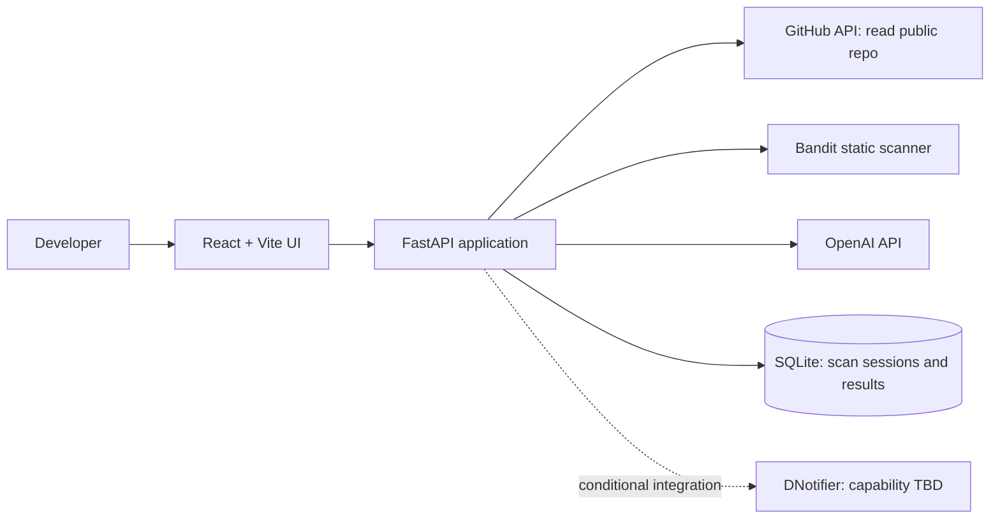
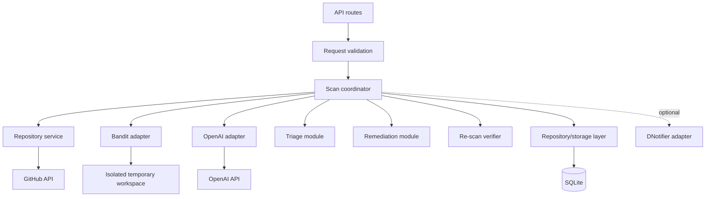

# 02 — System Architecture

## 1. Architecture style

Use a modular monolith: one React frontend and one FastAPI backend. Agent roles are modules/functions coordinated by backend code. Do not create separate microservices for the hackathon MVP.

## 2. Context diagram

## 3. Backend component diagram

## 4. Component responsibilities

### Frontend
- Collect a repository URL and selected finding.
- Display scan status, coverage, findings, source labels, diff, and verification result.
- Call backend endpoints only; never store the OpenAI key in browser code.
- Show loading, empty, partial, and error states distinctly.

### FastAPI routes
- Validate requests and return consistent response schemas.
- Enforce input limits and authorization policy if authentication is later added.
- Delegate work to services/coordinator; avoid embedding business logic in route handlers.

### Repository service
- Parse and validate GitHub repository URLs.
- Fetch metadata/tree/content through GitHub API.
- Allow only expected GitHub API destinations; defend against arbitrary URL fetches and path traversal.
- Enforce file and byte limits and produce coverage metadata.

### Scanner adapter
- Invoke Bandit on retrieved Python source in a controlled temporary workspace.
- Never execute project files or install repository dependencies.
- Parse machine-readable scanner output into the internal finding schema.
- Treat timeout, nonzero exit, malformed output, and tool-not-installed as explicit errors.

### AI adapter
- Send only bounded, relevant source snippets and scanner context.
- Ask for schema-constrained results where supported.
- Treat repository content as untrusted data, not instructions.
- Return AI observations and patch proposals with provenance labels.

### Coordinator
- Own the sequence and lifecycle of the workflow.
- Assign scan IDs and finding IDs.
- Record stage status, timings, errors, and coverage.
- Prevent a failed stage from being represented as successful.

### Storage
- Persist scan metadata, normalized findings, patch proposals, and verification results.
- Keep schema versioning simple and avoid storing secrets.

## 5. Technology choices

| Concern | MVP choice | Why |
|---|---|---|
| UI | React + Vite | Fast iteration and component-based dashboard. |
| API | Python + FastAPI | Fits scanner and AI integration; typed request/response schemas. |
| Static analysis | Bandit | Real Python security linting. |
| LLM | OpenAI API | Explain findings and propose changes. |
| Repository | GitHub API | Read public source with bounded access. |
| Storage | SQLite | Low operational overhead for a demo. |
| Tests | pytest + frontend test tooling as time permits | Repeatable behavior checks. |

## 6. Architecture decisions

- **ADR-001: Modular monolith.** Accepted. Reason: small team and limited time; easier to run and debug.
- **ADR-002: Python-only MVP.** Accepted. Reason: makes scanner coverage concrete and manageable.
- **ADR-003: No code execution.** Accepted. Reason: submitted repositories are untrusted.
- **ADR-004: Read-only GitHub.** Accepted. Reason: avoid unintended changes and token permissions.
- **ADR-005: Verify by re-scanning.** Accepted. Reason: a model's statement is not verification.
- **ADR-006: DNotifier is conditional.** Pending. Decide only after reviewing actual docs and testing its API.

## 7. Deployment shape

For local development, run Vite and FastAPI as separate processes. Deploy the frontend and backend separately only if the chosen hosting platform requires it. Configure secrets in backend environment variables. Do not commit `.env` files.
