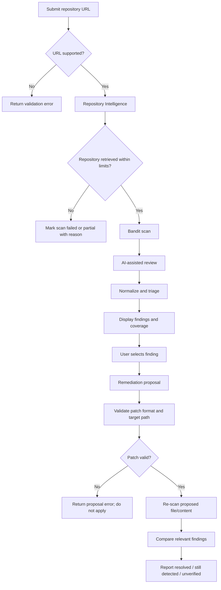

# 03 — Agent and Workflow Design

## 1. Important distinction

For the MVP, an “agent” is a bounded module with a defined input and output. It does not have unrestricted autonomy or tools. The coordinator controls the order, limits, and failure paths.

## 2. Workflow

## 3. Agent contracts

### A. Repository Intelligence Agent
**Purpose:** establish what the system can safely analyze.

Input: validated GitHub owner/repo/ref.

Output:
- repository identity and commit/ref where available;
- list of eligible Python files and manifests;
- excluded files with reasons;
- file count, byte totals, and coverage warnings.

Rules:
- Do not execute code.
- Do not follow arbitrary external URLs embedded in files.
- Reject path traversal and unusual paths.
- Apply configurable size and count limits.

### B. Security Analysis Agent
**Purpose:** collect deterministic findings and optional AI review observations.

Input: eligible source files, coverage metadata, Bandit output.

Output: normalized findings with `source_type`, rule/category, message, location, evidence, and confidence where supported.

Rules:
- Bandit results are tool findings, not guaranteed exploitable vulnerabilities.
- AI-only observations must use a separate source label.
- Missing scanner output or an AI timeout is a failure/partial result, not an empty list.

### C. Risk Triage Agent
**Purpose:** group related findings and recommend review order.

Input: normalized findings and available context.

Output: priority (`critical`, `high`, `medium`, `low`, `info`, or `unknown`), rationale, confidence, and manual-review flag.

Rules:
- Do not invent CVSS scores.
- Do not claim exploitability without evidence.
- Preserve original scanner severity and rule ID.
- Keep uncertain results visibly uncertain.

### D. Remediation Agent
**Purpose:** propose a reviewable change for one selected finding.

Input: finding, relevant source context, constraints, repository/ref metadata.

Output: explanation, target path, unified diff or replacement content, assumptions, and review notes.

Rules:
- Proposal only; never write to GitHub.
- Ensure target path belongs to the retrieved file set.
- Reject malformed diffs and paths outside the workspace.
- Do not describe the patch as safe until tested and re-scanned.

### E. Coordinator
**Purpose:** orchestrate all stages and preserve traceability.

Responsibilities:
- assign scan/finding/proposal IDs;
- enforce stage order and timeouts;
- record per-stage success/failure;
- pass only necessary context to each module;
- normalize exceptions into API errors;
- ensure incomplete scans are not marked clean.

## 4. Verification semantics

- `resolved`: the relevant scanner rule no longer reports the target issue in the changed file under the same configured scan conditions.
- `still_detected`: the relevant rule still reports the issue.
- `unverified`: the re-scan failed, coverage changed, the finding cannot be matched reliably, or the issue was AI-only and has no deterministic check.

A `resolved` status is scoped to the configured check and analyzed content. It does not mean the repository is fully secure.

## 5. Failure policy

- GitHub API failure → stop repository retrieval; return failed scan.
- Some files skipped due to limits → partial coverage warning.
- Bandit unavailable or failed → scanner stage failed; do not claim zero findings.
- OpenAI unavailable → scanner findings can still be displayed; AI analysis marked unavailable.
- Patch generation invalid → do not apply or re-scan malformed patch; show error.
- Re-scan failure → status `unverified`, not `resolved`.
