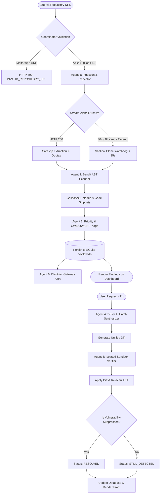

# 03 — Agent & Workflow System Design

**Version:** 2.2 — Production Operational Specification  
**Status:** Implemented & Verified in Production  
**Lead Designer & Software Engineer:** Faiqa Arooj (Bugfolio, SE-Tech Society, Google Developer Groups)  
**Target:** DevFlow AI Multi-Agent Orchestration Engine  

---

## 1. Multi-Agent Architectural Pattern

DevFlow AI rejects unconstrained, non-deterministic agent loops in favor of a **bounded coordinator-worker pipeline**. Each specialized agent has explicit input/output boundaries, strict runtime timeout gates, and deterministic fallback procedures.

---

## 2. Specialized Agent Roles & Contracts

### Agent 1: Repository Ingestion & Inspector Agent
- **Service Implementation:** [`backend/app/services/repo_service.py`](file:///Users/apple/Desktop/hackathon/backend/app/services/repo_service.py)
- **Input:** Validated GitHub URL (`owner`, `repo`, optional `ref`).
- **Core Function:** In-memory HTTP archive streaming (`/archive/HEAD.zip`) with fallback to shallow Git cloning (`--depth 1 --filter=blob:none`).
- **Safety Boundary:** Validates `os.path.commonpath([workspace, extracted_file]) == workspace` against Zip-Slip traversal. Rejects repositories exceeding 200 files, 250 KB per file, or 5 MB total unpacked size.

### Agent 2: Static Analysis & AST Scanner Agent
- **Service Implementation:** [`backend/app/services/bandit_service.py`](file:///Users/apple/Desktop/hackathon/backend/app/services/bandit_service.py)
- **Input:** Prepared directory containing passive Python source files.
- **Core Function:** Runs Bandit v1.7.9 AST visitor checks without importing, executing, or installing target code.
- **Safety Boundary:** Enforces `shell=False` with discrete token arrays (`["bandit", "-r", ..., "-f", "json"]`).

### Agent 3: Priority Triage & Taxonomy Classifier Agent
- **Service Implementation:** [`backend/app/services/triage_service.py`](file:///Users/apple/Desktop/hackathon/backend/app/services/triage_service.py)
- **Input:** Raw Bandit findings and code context.
- **Core Function:** Normalizes finding schemas, maps rule IDs to OWASP Top 10 (2021) and MITRE CWE identifiers, and computes deterministic priority rankings (`critical`, `high`, `medium`, `low`).

### Agent 4: 3-Tier Remediation & Patch Synthesizer Agent
- **Service Implementation:** [`backend/app/services/ai_service.py`](file:///Users/apple/Desktop/hackathon/backend/app/services/ai_service.py)
- **Input:** Specific security finding, line range, and code snippet.
- **3-Tier Execution Hierarchy:**
  1. *Tier 1 (Primary):* Google Gemini 2.0 Flash (`gemini-2.0-flash`).
  2. *Tier 2 (Secondary):* OpenAI GPT-4o-mini (`gpt-4o-mini`).
  3. *Tier 3 (Offline Rule Engine):* Deterministic AST patch synthesis for B104 (wildcard bind), B108 (tempfile handling), B110 (try-except-pass), and B602 (subprocess shell).

### Agent 5: Ephemeral Sandbox Verifier Agent
- **Service Implementation:** [`backend/app/services/verification_service.py`](file:///Users/apple/Desktop/hackathon/backend/app/services/verification_service.py)
- **Input:** Original source file snippet and synthesized patch diff.
- **Core Function:** Creates a disposable temporary workspace, writes the patched file, and executes a targeted Bandit AST re-scan.
- **Output:** Proof ledger certifying whether the vulnerability is `resolved`, `still_detected`, or `unverified`.

### Agent 6: DNotifier Gateway Agent
- **Service Implementation:** [`backend/app/services/dnotifier_service.py`](file:///Users/apple/Desktop/hackathon/backend/app/services/dnotifier_service.py)
- **Input:** Completed scan summary, findings count, and repository metadata.
- **Core Function:** Dispatches an HMAC-SHA256 signed JSON alert event to the DNotifier gateway asynchronously, providing non-blocking notification delivery.
