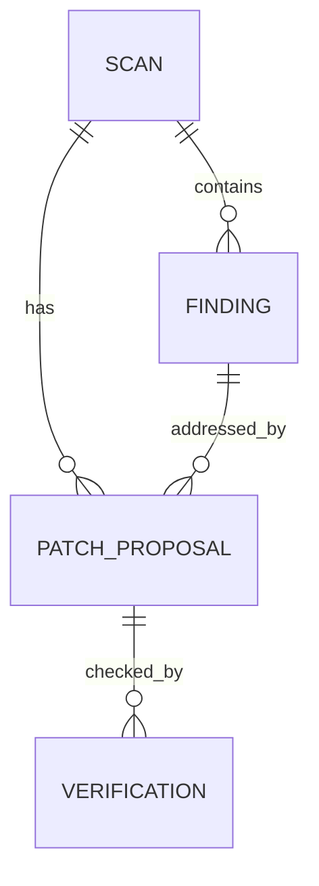

# 05 — Data Model

## 1. Core entities

### Scan
- `scan_id` — unique identifier.
- `repository_url` — normalized public repository URL.
- `owner`, `repository_name`, `ref`, `commit_sha` where available.
- `status` — queued/running/completed/completed_with_warnings/failed.
- `started_at`, `completed_at`.
- `coverage_json` — discovered/analyzed/skipped files and reasons.
- `error_code`, `error_message` — sanitized failure information.

### Finding
- `finding_id`, `scan_id`.
- `source_type` — bandit, ai_review, or combined with provenance.
- `rule_id`, `title`, `message`.
- `severity` — scanner-provided severity where applicable.
- `priority` and `priority_rationale` — triage recommendation.
- `confidence`, `manual_review_required`.
- `file_path`, `line_start`, `line_end`, `evidence`.

### PatchProposal
- `proposal_id`, `scan_id`, `finding_id`.
- `target_path`, `diff` or replacement content.
- `explanation`, `assumptions`, `review_notes`.
- `status` — proposed/rejected/invalid.
- `created_at`.

### Verification
- `verification_id`, `proposal_id`, `scan_id`.
- `status` — resolved/still_detected/unverified.
- `checks_run`, `evidence`, `limitations`.
- `created_at`.

## 2. Relationships

## 3. Storage plan

Start with SQLite for persistence if the demo needs scan history. Keep database access behind a small repository/storage module so the implementation can move to PostgreSQL later without changing agent logic.

For the first vertical slice, in-memory storage is acceptable temporarily, but the team should not confuse it with durable persistence.

## 4. Data handling

- Never store API keys in these tables.
- Minimize retention of full source files; store only what is required for traceability.
- Redact likely secrets from evidence before persisting or sending to logs.
- Store commit/ref identity so findings can be tied to the version scanned.
- Treat source snippets and model outputs as untrusted data.
