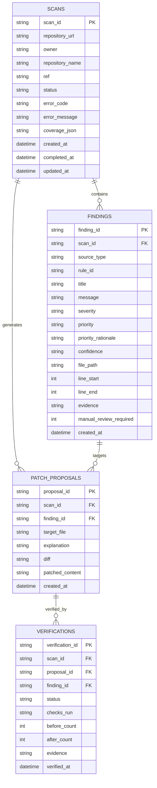

# 05 — Data Model & Storage Architecture

**Version:** 2.2 — Production Operational Schema  
**Status:** Implemented & Verified in Production  
**Lead Designer & Software Engineer:** Faiqa Arooj (Bugfolio, SE-Tech Society, Google Developer Groups)  
**Target:** DevFlow AI Persistent Storage Engine (`backend/app/db/database.py`)  

---

## 1. Storage Architecture Overview

DevFlow AI uses an embedded **SQLite 3** relational database (`devflow.db`) designed for low latency, zero external database maintenance, and portable serverless deployment.

- **Concurrency & Journaling:** Write-Ahead Logging (`PRAGMA journal_mode=WAL;`) is enabled on all connections to support non-blocking concurrent reads while background analysis tasks write.
- **Path Isolation:**
  - Local execution: Resolves to `./devflow.db` at workspace root.
  - Serverless execution (`VERCEL=1`): Automatically redirects write transactions to ephemeral `/tmp/devflow.db` to comply with read-only root filesystems.
- **Connection Management:** Context-managed thread-safe connection pooling implemented in [`backend/app/db/database.py`](file:///Users/apple/Desktop/hackathon/backend/app/db/database.py).

---

## 2. Entity-Relationship Model



---

## 3. Production DDL Schema

```sql
-- Scans Ledger
CREATE TABLE IF NOT EXISTS scans (
    scan_id TEXT PRIMARY KEY,
    repository_url TEXT NOT NULL,
    owner TEXT,
    repository_name TEXT,
    ref TEXT,
    status TEXT NOT NULL, -- queued, running, completed, completed_with_warnings, failed
    error_code TEXT,      -- INVALID_REPOSITORY_URL, REPOSITORY_ERROR, SCAN_ERROR
    error_message TEXT,
    coverage_json TEXT,   -- serialized metadata on analyzed/skipped files
    created_at TEXT DEFAULT CURRENT_TIMESTAMP,
    completed_at TEXT,
    updated_at TEXT DEFAULT CURRENT_TIMESTAMP
);

-- Normalized Security Findings
CREATE TABLE IF NOT EXISTS findings (
    finding_id TEXT PRIMARY KEY,
    scan_id TEXT NOT NULL REFERENCES scans(scan_id) ON DELETE CASCADE,
    source_type TEXT NOT NULL, -- bandit, heuristic, ai_review
    rule_id TEXT NOT NULL,     -- B104, B108, B110, B602, etc.
    title TEXT NOT NULL,
    message TEXT NOT NULL,
    severity TEXT NOT NULL,    -- high, medium, low
    priority TEXT NOT NULL,    -- critical, high, medium, low
    priority_rationale TEXT,
    confidence TEXT NOT NULL,  -- high, medium, low
    file_path TEXT NOT NULL,
    line_start INTEGER,
    line_end INTEGER,
    evidence TEXT,
    manual_review_required INTEGER DEFAULT 0,
    created_at TEXT DEFAULT CURRENT_TIMESTAMP
);

-- AI Patch Proposals
CREATE TABLE IF NOT EXISTS patch_proposals (
    proposal_id TEXT PRIMARY KEY,
    scan_id TEXT NOT NULL REFERENCES scans(scan_id) ON DELETE CASCADE,
    finding_id TEXT NOT NULL REFERENCES findings(finding_id) ON DELETE CASCADE,
    target_file TEXT NOT NULL,
    explanation TEXT,
    diff TEXT NOT NULL,
    patched_content TEXT NOT NULL,
    created_at TEXT DEFAULT CURRENT_TIMESTAMP
);

-- Sandbox Verifications Ledger
CREATE TABLE IF NOT EXISTS verifications (
    verification_id TEXT PRIMARY KEY,
    scan_id TEXT NOT NULL REFERENCES scans(scan_id) ON DELETE CASCADE,
    proposal_id TEXT NOT NULL REFERENCES patch_proposals(proposal_id) ON DELETE CASCADE,
    finding_id TEXT NOT NULL REFERENCES findings(finding_id) ON DELETE CASCADE,
    status TEXT NOT NULL,      -- resolved, still_detected, unverified
    checks_run TEXT NOT NULL,  -- JSON array of security check IDs
    before_count INTEGER DEFAULT 1,
    after_count INTEGER DEFAULT 0,
    evidence TEXT,
    verified_at TEXT DEFAULT CURRENT_TIMESTAMP
);

-- Performance Indexes
CREATE INDEX IF NOT EXISTS idx_findings_scan_id ON findings(scan_id);
CREATE INDEX IF NOT EXISTS idx_proposals_scan_id ON patch_proposals(scan_id);
CREATE INDEX IF NOT EXISTS idx_proposals_finding_id ON patch_proposals(finding_id);
CREATE INDEX IF NOT EXISTS idx_verifications_scan_id ON verifications(scan_id);
CREATE INDEX IF NOT EXISTS idx_verifications_proposal_id ON verifications(proposal_id);
```

---

## 4. Data Sanitization & Secret Retention Policy

1. **Zero Credential Ingestion:** Any tokens, secrets, or API keys matched in repository files during scanning are redacted in memory before insertion into the `evidence` field.
2. **Commit Immutability:** Each scan is linked to the repository ref or commit sha when provided, ensuring historical scans represent frozen audit snapshots.
3. **Database Portability:** The SQLite database format allows instant offline inspection via standard CLI tools (`sqlite3 devflow.db`) without requiring remote daemon setup.
