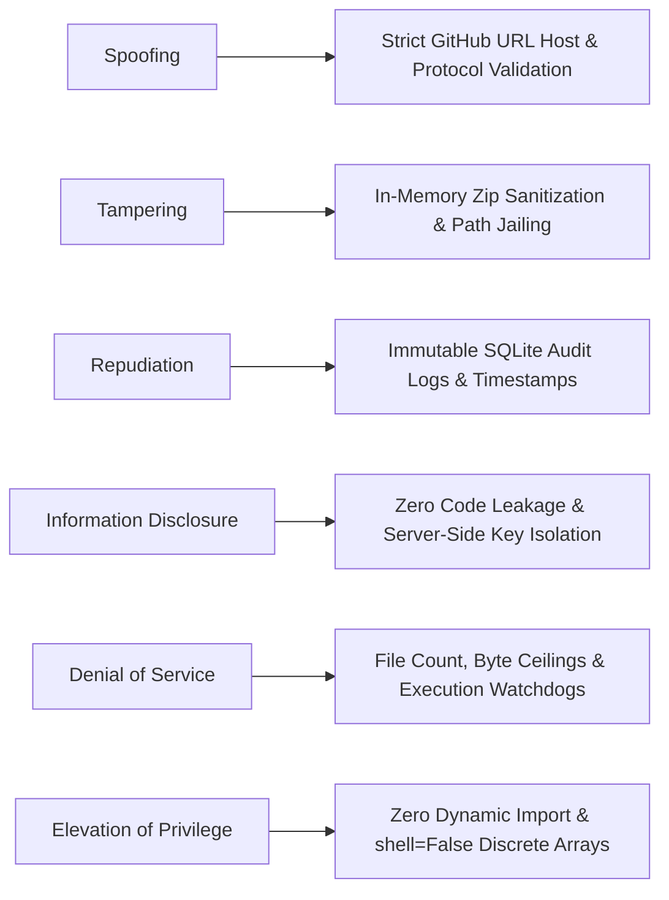

# 06 — Security Architecture & Threat Model

**Version:** 2.2 — Production Hardened Specification  
**Status:** Implemented & Verified in Production  
**Lead Designer & Software Engineer:** Faiqa Arooj (Bugfolio, SE-Tech Society, Google Developer Groups)  
**Target:** DevFlow AI Zero-Trust Platform Hardening  

---

## 1. Zero-Trust Security Philosophy

DevFlow AI processes arbitrary, untrusted public code from third-party repositories. The system operates on a zero-trust model:
1. **Never Execute Untrusted Code:** Repositories are never run, compiled, or dynamically imported.
2. **Never Trust File Paths in Archives:** Every ZIP entry path is cryptographically validated before file creation.
3. **Never Trust AI Fix Proposals Without Verification:** Proposed code diffs must pass independent sandbox re-scan verification before being presented as resolved.

---

## 2. STRIDE Threat Model

| STRIDE Category | Threat Description | Attack Vector | DevFlow AI Countermeasure |
|---|---|---|---|
| **Spoofing** | SSRF or internal network probing via crafted URLs | Submitting loopback or local URLs (`http://127.0.0.1`, `http://169.254.169.254`) | Host validation strictly enforces `https://github.com/` with alphanumeric regex. |
| **Tampering** | Directory traversal / Zip-Slip file overwriting | Malicious archive containing `../../etc/passwd` or overwrite attacks | Extractor validates `os.path.commonpath([workspace, target_file]) == workspace` before writing. |
| **Repudiation** | Disputing security audit findings or provenance | Claiming findings were fabricated or taken from a different commit | Scans store the exact ref/commit SHA, timestamp, and line ranges in persistent SQLite storage. |
| **Information Disclosure** | Leakage of API keys or user repository code | Prompt injection in repo comments extracting server env keys | AI prompts treat repository source strictly as passive data inside delimited blocks; keys never leave backend memory. |
| **Denial of Service** | Giant 10 GB repository submissions exhausting memory | Decompression bombs or massive monorepos | Strict quotas enforced: max 200 files, max 250 KB per file, max 5 MB total unpacked footprint. |
| **Elevation of Privilege** | Arbitrary code execution during analysis | Malicious `setup.py`, `__init__.py`, or `Makefile` | Pure passive AST analysis via Bandit v1.7.9. Code is parsed as token trees, never imported or evaluated. |

---

## 3. Sandboxing & Patch Isolation Architecture

When verifying proposed patches:
1. An ephemeral workspace is provisioned using `tempfile.TemporaryDirectory()`.
2. The patched content is written to a designated isolated file path.
3. Bandit AST linting is executed with discrete arguments (`shell=False`).
4. Output results are parsed in memory, and the workspace is completely purged immediately upon completion.
