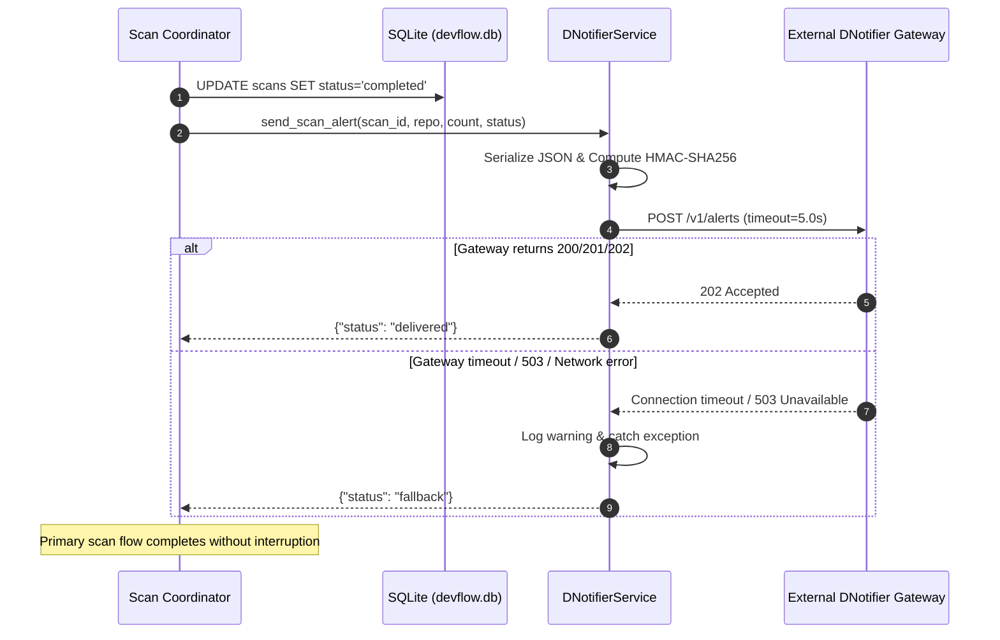

# 09 — DNotifier Integration & Notification Architecture

**Version:** 2.2 — Production Operational Specification  
**Status:** Implemented & Verified  
**Lead Designer & Software Engineer:** Faiqa Arooj (Bugfolio, SE-Tech Society, Google Developer Groups)  
**Target:** DevFlow AI Real-Life Event Notification Subsystem  

---

## 1. Executive Summary & Production Status

DNotifier is integrated as a capability-gated, non-blocking asynchronous security alert gateway. Upon scan completion (or critical security failure), DevFlow AI synthesizes a signed alert event payload and dispatches it to the DNotifier endpoint without blocking user response times or causing scan failures if the external notification gateway is degraded.

- **Implementation Module:** [`backend/app/services/dnotifier_service.py`](file:///Users/apple/Desktop/hackathon/backend/app/services/dnotifier_service.py)
- **Credential Storage:** Loaded securely via [`backend/app/config.py`](file:///Users/apple/Desktop/hackathon/backend/app/config.py) from environment variables (`APP_ID`, `APP_SECRET`, `DNOTIFIER_API_URL`).
- **Resilience Pattern:** Circuit-breaker style non-blocking asynchronous dispatch with strict 5.0s timeout and graceful fallback logging.

---

## 2. Authentication & Cryptographic Integrity

### 2.1 HMAC-SHA256 Signature Verification
To guarantee tamper-proof delivery, every outbound event payload is signed using the application secret:

```python
signature = hmac.new(
    app_secret.encode("utf-8"),
    payload_bytes,
    hashlib.sha256
).hexdigest()
```

### 2.2 Request Headers Contract
```http
POST /v1/alerts HTTP/1.1
Host: api.dnotifier.com
Content-Type: application/json
X-DNotifier-App-Id: app_2961169878de0d530b523473
X-DNotifier-Signature: 6c23eb7265f731cd4c3c2ef281b840c3c97e510eea1325ad9063c05c7d3c2e50...
```

---

## 3. Real-Life Event Payload Schema

```json
{
  "app_id": "app_2961169878de0d530b523473",
  "event": "security.scan_completed",
  "timestamp": 1740000000,
  "data": {
    "scan_id": "scan_8f3a9e21",
    "repository_url": "https://github.com/octocat/Hello-World",
    "findings_count": 3,
    "status": "completed",
    "summary": {
      "files_analyzed": 14,
      "files_skipped": 0,
      "total_bytes": 142050,
      "highest_severity": "high",
      "top_cwe": "CWE-78"
    }
  }
}
```

---

## 4. Architectural State Flow



---

## 5. Security & Isolation Directives

1. **Zero Credential Leakage:** API credentials (`APP_ID`, `APP_SECRET`) are never included in repository export archives, client-side bundles, or SQLite database logs.
2. **Payload Sanitization:** No raw source code or un-redacted user repository secrets are sent in notification payloads; only finding counts, rule IDs, and metadata are dispatched.
3. **Fault Tolerance:** If DNotifier experiences downtime (e.g. HTTP 503 or DNS resolution timeout), the scan pipeline logs the incident and returns success to the user interface.
