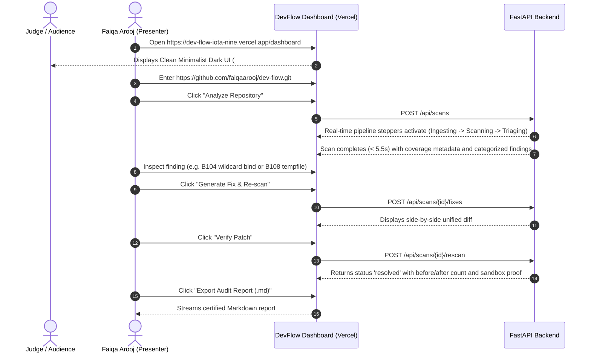

# 10 — Live Demonstration Runbook & Presentation Architecture

**Version:** 2.2 — Production Operational Specification  
**Status:** Certified & Verified  
**Lead Presenter & Software Engineer:** Faiqa Arooj (Bugfolio, SE-Tech Society, Google Developer Groups)  
**Target:** DevFlow AI Hackathon Presentation & Live Evaluation  

---

## 1. Demonstration Objective

To demonstrate the complete, unbroken, real-life DevFlow AI remediation loop live:
1. **Repository Ingestion:** Ingest a real GitHub repository without code execution.
2. **AST Static Vulnerability Analysis:** Detect authentic security flaws using Bandit v1.7.9.
3. **Automated Priority Triage:** Map findings directly to MITRE CWE and OWASP Top 10 (2021).
4. **Remediation & Patch Synthesis:** Synthesize atomic unified diffs (`.diff`).
5. **Ephemeral Sandbox Verification:** Execute re-scans in a disposable workspace proving vulnerability suppression.
6. **One-Click Deliverables Export:** Download the PRD, System Design, and Dynamic Security Audit report.

---

## 2. Tested Live Repository Target

- **Demo Repository URL:** `https://github.com/faiqaarooj/dev-flow.git`
- **Alternative Public Target:** `https://github.com/octocat/Hello-World`
- **Expected Turnaround Time:** < 5.5 seconds total end-to-end execution.

---

## 3. Step-by-Step Live Sequence

---

## 4. Key Architectural Differentiators to Emphasize

1. **Closed-Loop Verification vs. Hallucinated AI Output:**  
   Most security AI tools propose code that fails to fix the issue or breaks syntax. DevFlow AI re-runs Bandit AST analysis inside an isolated sandbox to *empirically prove* suppression before recommending the change.
2. **Zero Code Execution Safety Guarantee:**  
   Unlike insecure tools that run `pip install` or `python setup.py`, DevFlow AI parses Python code strictly as a passive Abstract Syntax Tree.
3. **Deployment-Hardened Edge Resilience:**  
   Dual-mode execution architecture adapts automatically between local ASGI workers and Vercel serverless execution, with SPA client rewrites preventing 404 navigation errors.

---

## 5. Defense & Technical Question Answers

- **Q: How does the system handle malicious repositories attempting Zip-Slip attacks?**  
  *Answer:* The ingestion service inspects every compressed member and computes `os.path.commonpath([workspace, target]) == workspace`. If path traversal (`../../`) is detected, the scan immediately aborts with `INSECURE_ARCHIVE_PATH`.
- **Q: What role does DNotifier play?**  
  *Answer:* DNotifier acts as an external notification gateway. When a scan completes, DevFlow AI computes an HMAC-SHA256 signature and dispatches an asynchronous event alert without blocking the UI response.
- **Q: What happens if Gemini or OpenAI APIs are unreachable or have no keys configured?**  
  *Answer:* DevFlow AI operates a 3-tier hierarchy: Gemini 2.0 Flash (Tier 1) -> OpenAI GPT-4o-mini (Tier 2) -> deterministic AST offline rule engine (Tier 3), guaranteeing uninterrupted patch synthesis even without network AI connectivity.
